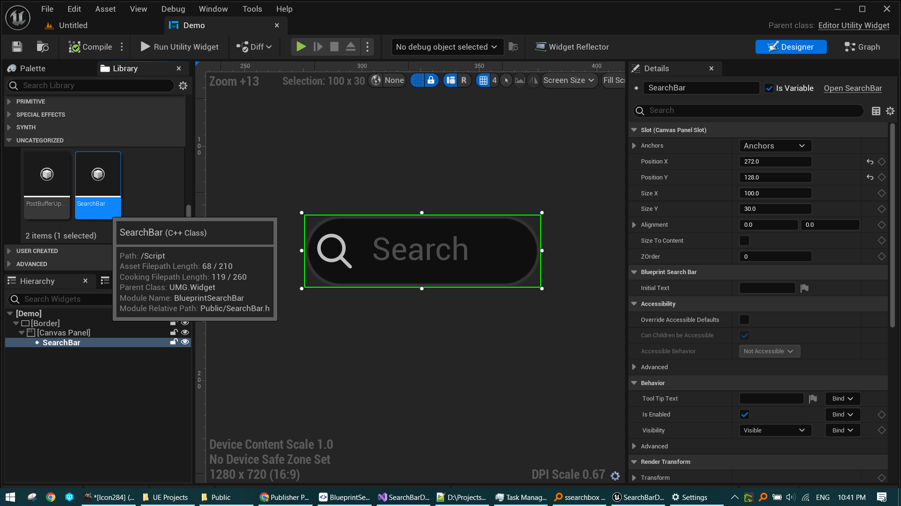

# Blueprint Search Bar
### The native Slate-based search bar of Unreal Engine exposed to Blueprints

The Blueprint Search Bar plugin exposes the functionality of the powerful Slate search bar widget to Unreal Engine Blueprints, providing a user-friendly solution for developers who prefer working with Blueprints over C++. It is designed to enhance productivity and streamline workflow, and it allows developers to easily implement an advanced search bar in both runtime environments and Editor Utility Widgets, all while ensuring platform independence.

## Features:
 - Native Slate search bar (magnifying glass, clear button, hint text) as a UMG widget, found under **Input** in the palette.
 - Works in runtime UI and in Editor Utility Widgets.
 - Events: **On Search Text Changed** (also fires on the clear button) and **On Search Text Committed** (Enter or focus lost).
 - Blueprint functions: **Get Text**, **Set Text**, **Clear Text**, **Get Hint Text**, **Set Hint Text**, **Focus Search Bar**.
 - Designer options: Initial Text, Hint Text, Select All Text When Focused, Delay Change Notifications While Typing (and delay seconds), Min Desired Width.
 - Supports Unreal Engine 5.4 to 5.8 on Windows, Mac, Linux, iOS and Android.

## Changelog
 - **1.1**: Added Get/Set/Clear Text, hint text, focus, typing-delay and width options; UE 5.7 and 5.8 support; safer event binding.
 - **1.0**: Initial release.

## How to Use:
1. Clone the repository to your local machine.
2. Launch the SearchBarDemo project in Unreal Editor.
3. Go to Contents folder and right click on the editor utility widget called Demo in the Contents folder and click on 'Run Editor Utility Widget' in the context menu.

Screenshot:

